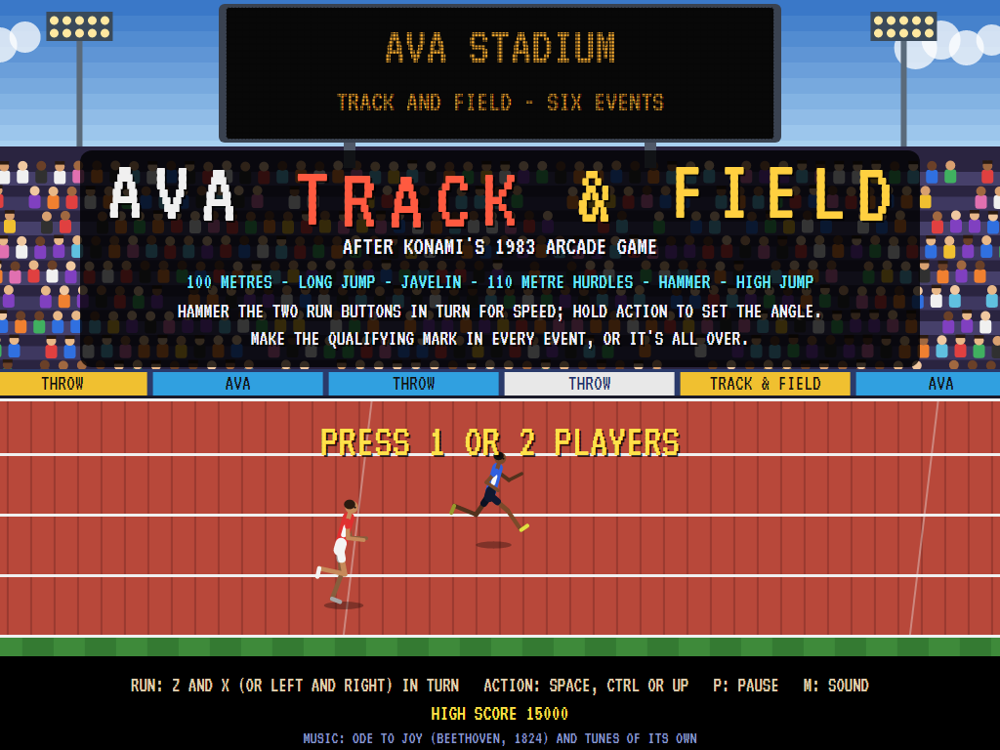
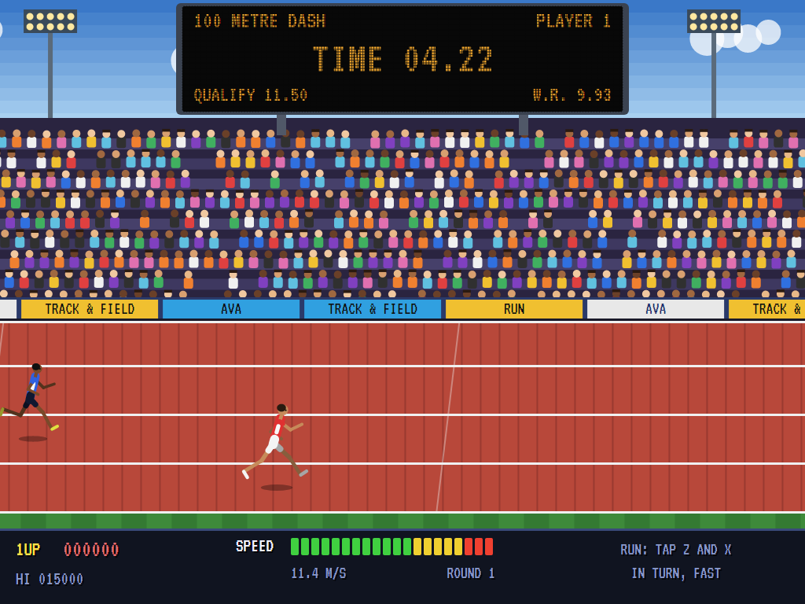
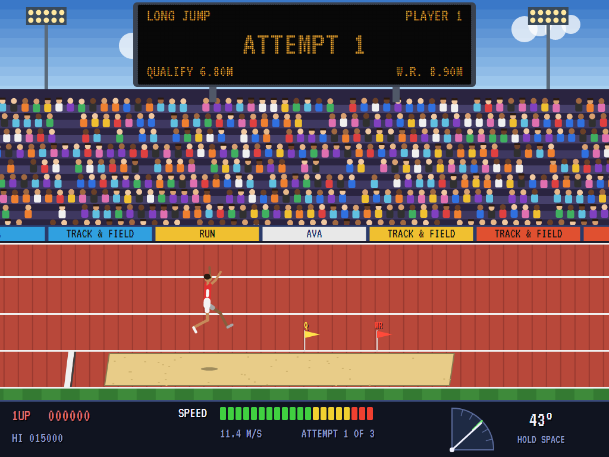
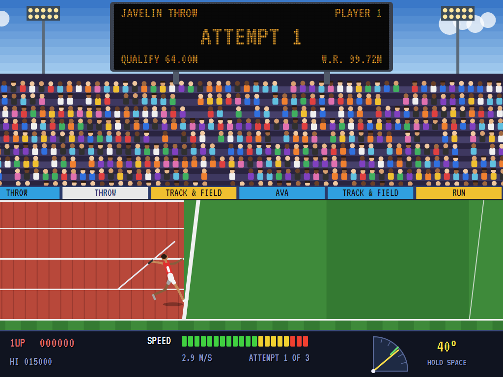
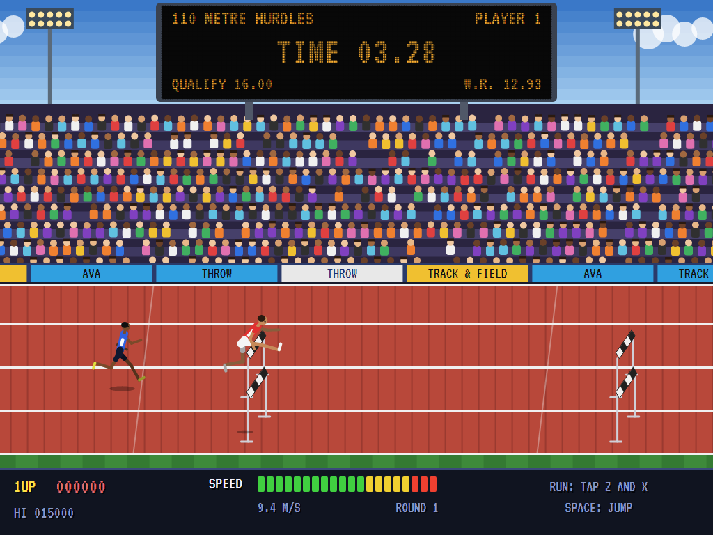
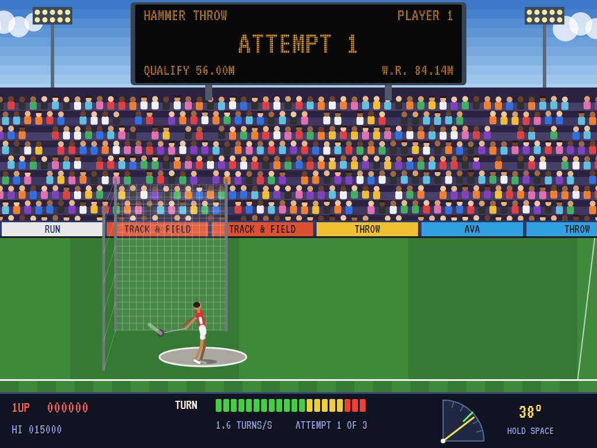
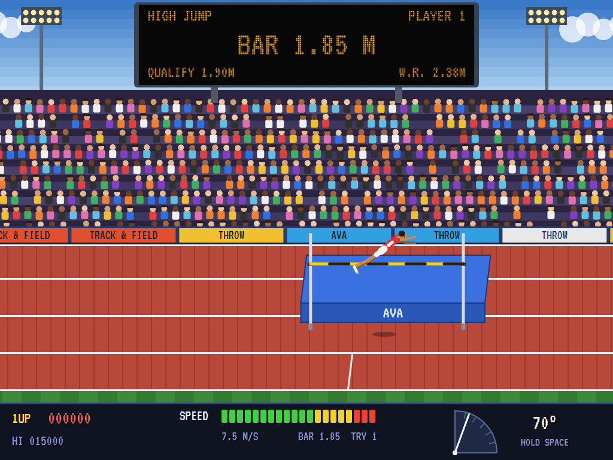
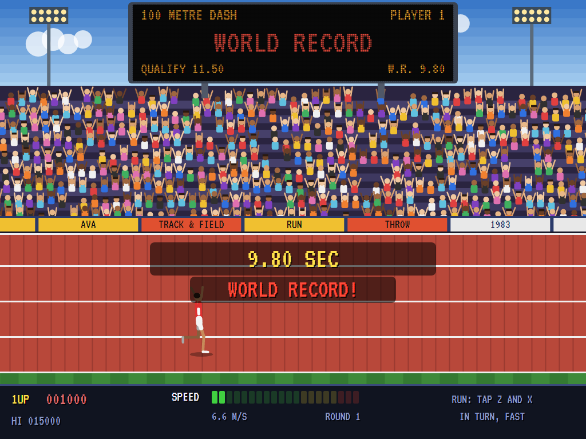
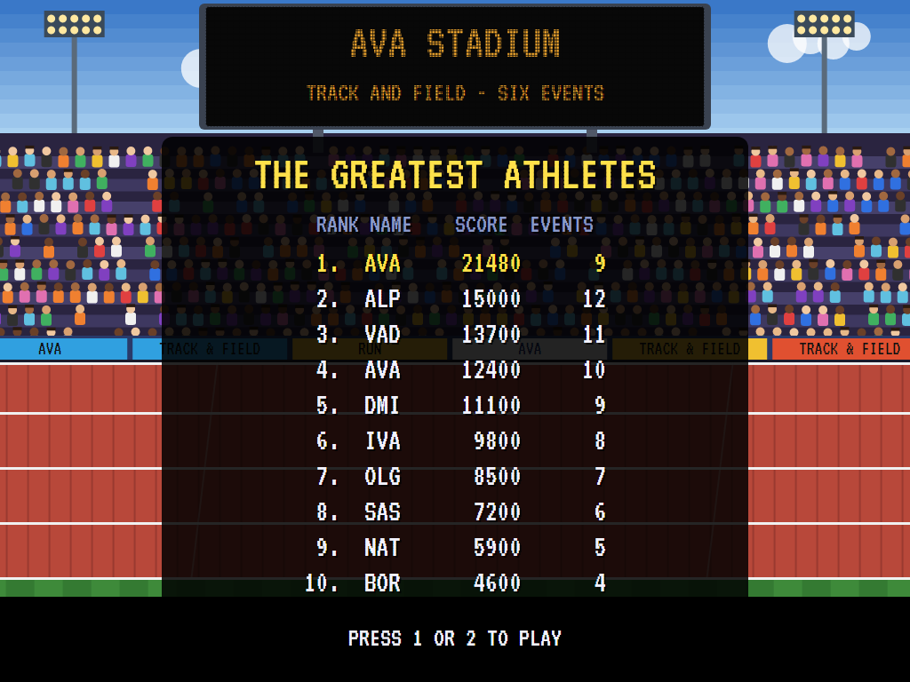

# AVA Track & Field

[](https://github.com/Harlock123/AVATrackAndField/actions/workflows/build.yml)

An athletics meeting in the style of Konami's 1983 arcade game **Track & Field** (Hyper Olympic), built with .NET 10
and Avalonia UI. Six events in a packed stadium: the 100 metre dash, the long jump, the javelin, the 110 metre
hurdles, the hammer and the high jump. Hammer the two RUN buttons in turn for speed, hold ACTION to set the angle,
and make the qualifying mark in every event, or it's all over. Then round again, with stiffer marks.

## Features

- **Power from your fingers.** Each tap of a RUN button drives the athlete on; the faster you tap, the faster he
  goes, up to flat out at ten taps a second. The two buttons go in turn: hammering the same one twice running is
  only half a tap. The **speed meter** shows how fast you're tapping, and falls the moment you stop. Taps are key
  presses: holding a key down, and the keyboard repeating it, counts for nothing.
- **Six events, in the original's order:**
  - **100 metre dash.** On your marks, set, and the gun; away before it is a false start, and two is out. A rival
    runs in the next lane.
  - **Long jump.** Press ACTION at the board and he plants for the jump; hold it while the angle rises, and let go.
    The best angle is about 43°. Over the board is a foul. Three jumps; the best counts.
  - **Javelin.** Press ACTION to draw the javelin back: he brakes hard, the angle rising as you hold. Let go to
    throw. Cross the line, before the throw or after it, and it's a foul. The best angle is about 44°.
  - **110 metre hurdles.** Ten hurdles; ACTION to jump each, timed so the hurdle is under the top of the jump.
    Run through one and it goes down, and so does your speed.
  - **Hammer.** Tap to turn faster and faster in the circle; hold ACTION to set the angle, and let go as the hammer
    swings down the field. Let go out of the sector and it hits the cage.
  - **High jump.** Run in, take off just outside the mark, hold ACTION for a steep angle, then press it again as
    you go over to kick your legs clear. Clear the bar and it goes up five centimetres; three misses at a height
    and the event is over.
- **Qualifying.** Each event has a mark to make. Make it and you go on; miss it and the game is over. The marks
  get stiffer each time round the six events, and the rival quicker.
- **The scoreboard** shows the event, the clock or the mark, the qualifying mark and the world record, in amber
  lamps. Beat a **world record** and it flashes on the board, the crowd rises, and it's worth 1,000 points; the
  records start at the marks of 1983 and are kept between games.
- **Points** for every event, on a table like the decathlon's: about 1,000 for a first-round qualifying mark,
  2,000 for a world-class one.
- **One or two players**, taking each event in turn. A player who fails to qualify is out; the other goes on.
- **The attract mode** shows the computer athlete. It taps at a steady rate and times ACTION as a good player
  learns to; while ACTION is held it tries every moment to let go on a copy of the world, and takes the best.
  Flat out it runs 9.80, jumps 9.14 m, throws the javelin 102 m and the hammer 85 m, hurdles in 12.58 and clears
  2.40 m.

## Screenshots

| The title | The 100 metre dash | The long jump |
|:---------:|:------------------:|:-------------:|
|  |  |  |
| | The rival in the next lane. | Off the board at 43°. |

| The javelin | The 110 metre hurdles | The hammer |
|:-----------:|:---------------------:|:----------:|
|  |  |  |
| Drawn back, the angle rising. | The hurdle under the top of the jump. | Turning flat out. |

| The high jump | A world record | The greatest athletes |
|:-------------:|:--------------:|:---------------------:|
|  |  |  |
| Over the bar on his back. | 9.80 in the dash. | |

The screenshots are made by the tests, which play the game in a real (headless) window; see
[Tests](#tests).

## Download and run

Ready-to-run builds for Windows, macOS and Linux, on both Intel/AMD and ARM, are on the
[Releases page](https://github.com/Harlock123/AVATrackAndField/releases/tag/latest). **Latest build** is
rebuilt on every push to `main`. Each download is one self-contained executable: no .NET install is
needed.

| Platform | Archive |
|---|---|
| Windows | `AVATrackAndField-win-x64.zip`, `AVATrackAndField-win-x86.zip`, `AVATrackAndField-win-arm64.zip` |
| macOS | `AVATrackAndField-osx-arm64.tar.gz` (Apple silicon), `AVATrackAndField-osx-x64.tar.gz` (Intel) |
| Linux | `AVATrackAndField-linux-x64.tar.gz`, `AVATrackAndField-linux-arm64.tar.gz`, `AVATrackAndField-linux-arm.tar.gz` |

```bash
tar -xzf AVATrackAndField-linux-x64.tar.gz     # or linux-arm64, linux-arm, osx-arm64, osx-x64
./AVATrackAndField
```

On Windows, unzip and run `AVATrackAndField.exe`. On macOS, if Gatekeeper refuses to open it, run
`xattr -d com.apple.quarantine AVATrackAndField` once. Run with `--no-audio` for silence.

**Sound** comes through OpenAL Soft, built in for every platform. In a virtual machine the game
detects it and uses a larger audio buffer, so the sound doesn't break up.

**Gamepads** use SDL2, which is bundled for Windows, macOS and Intel/AMD Linux. ARM Linux builds need it
installed; without it the keyboard still works:

```bash
sudo apt install libsdl2-dev            # Debian / Ubuntu / Raspberry Pi OS
sudo pacman -S --needed sdl2-compat     # Arch / Omarchy
```

## Controls

| Action | Keyboard | Gamepad |
|---|---|---|
| Start, one player | Enter or 1 (or ACTION on the title) | Start |
| Start, two players | 2 | |
| Run (tap the two in turn) | Z and X, or Left and Right (or A and D) | A and B |
| ACTION: jump, throw; hold to set the angle | Space, Ctrl, Up or Shift | X, Y, a bumper or the right trigger |
| Pause | P or Esc | Start |
| Sound on/off | M | |
| Screenshot | Ctrl+S (to your Pictures folder) | |

On the high-score table, type your initials, or use up/down and Space, then Enter.

## Tests

```bash
dotnet test AVATrackAndField.slnx
```

The game runs in fixed 60 Hz steps, so it plays the same at any frame rate. Everything that changes in an attempt
lives in one world that can be copied. The tests check:

- **Tapping:** faster tapping running faster, up to flat out; two buttons in turn beating one hammered as fast;
  the meter following the tapping and falling when it stops; taps counted once whatever the frame rate.
- **The dash:** on your marks, set and the gun; the clock to the line; the rival; a false start, and two out.
- **The hurdles:** a jump at the right moment clearing a hurdle, too early or not at all knocking it down; the
  computer hurdler clean over all ten.
- **The long jump and javelin:** the angle rising while ACTION is held; the best angle between 42° and 45° (46° for
  the javelin); a faster run-up going further; over the board or the line a foul, even after the throw.
- **The hammer:** faster tapping turning faster and throwing further; let go out of the sector into the cage; too
  long in the circle a foul.
- **The high jump:** the kick making the difference at the top; too close a miss; the bar going up after a
  clearance, and three misses the end.
- **The game:** three attempts and the best counting; failing to qualify the end, and a high score entered;
  qualifying going on to the next event and round again harder; world records flashing, scoring and kept (but
  never by the demonstration); points; two players in turn; the title, the demonstration and the high scores.
- **The keys,** through the input handler: Z and X and the arrows as the run buttons; a held key repeating,
  either way the keyboard sends it, never a tap; ACTION held, and a press too quick to see still counted; a Shift
  let go as CapsLock let go.
- **The computer athlete** qualifying through two whole rounds.

`tests/AVATrackAndField.Tests/PilotProbe.cs` reports how the computer athlete gets on at each event at a range of
tapping rates, and then plays a whole game, for tuning (`TRACK_PROBE=1`). It qualifies round after round, seven
rounds in half an hour of play.

The screenshot tests draw the real screen in a headless window. To refresh the README's pictures:

```bash
TRACK_SHOTS=$PWD/Images dotnet test tests/AVATrackAndField.Tests --filter ScreenshotTests
```

## Building

```bash
dotnet build AVATrackAndField.slnx
dotnet run --project src/AVATrackAndField
```

Needs the .NET 10 SDK. The sounds, music and the starter's voice are made by `tools/make_sounds.py`
(standard-library Python, with the formant voice in `tools/speech.py`): `python3 tools/make_sounds.py` rewrites
`src/AVATrackAndField/Sounds`.

## Project structure

```
AVATrackAndField/
├── AVATrackAndField.slnx
├── src/AVATrackAndField/
│   ├── Engine/
│   │   ├── GameEngine.cs        # States, players, events and attempts, qualifying, rounds, the demonstration
│   │   ├── Sim.cs               # The rules of the six events: tapping, running, angles, flights, fouls, marks
│   │   ├── World.cs             # The athletes, the javelin or hammer, the hurdles and the bar, kept so it can be copied
│   │   ├── Pilot.cs             # The computer athlete (the demonstration, and the tests)
│   │   ├── Records.cs           # The world records, kept between games
│   │   ├── HighScoreTable.cs, InitialsEntry.cs
│   │   ├── InputHandler.cs, ControllerManager.cs  # Keys (taps, not repeats) and an SDL2 gamepad
│   │   └── SoundManager.cs      # Effects, music and the crowd through OpenAL
│   ├── Audio/                   # The OpenAL engine (from the author's AVABand)
│   ├── Views/GameCanvas*.cs     # The stadium, the crowd, the scoreboard, the athletes, the meters
│   └── Sounds/                  # The synthesised effects, music, crowd and voice
├── tests/AVATrackAndField.Tests/  # Gameplay and screenshot tests
├── tools/make_sounds.py, tools/speech.py
└── Images/                      # Screenshots
```

## About and licence

AVA Track & Field © 2026 Lonnie Watson, under the [MIT License](LICENSE).

*Track & Field* © 1983 Konami; the names *Track & Field* and *Hyper Olympic* belong to their owners. AVA Track &
Field is an independent, unofficial game in its style. Its graphics, sounds and code are its own; nothing is taken
from the original game's program, graphics or sound. It is not affiliated with or endorsed by Konami or any other
rights holder. The title music is the *Ode to Joy* from Beethoven's Ninth Symphony (1824), in the public domain;
the fanfares and jingles are the game's own.
